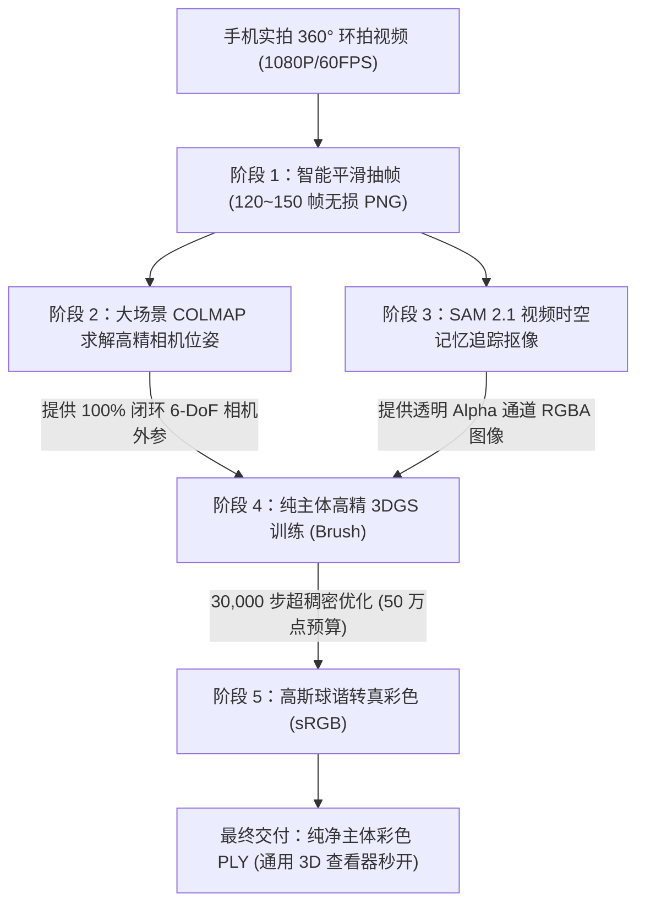

# 实拍物体纯主体 50 万高精 3DGS 三维重建标准操作方案 (SOP)

> 本文随 `feat/ui-redesign` 导入，其中既有验证记录属于原分支；本次工作区整合结果见[地图分支整合](map-ui-redesign-integration.md)。

> 本方案总结自星羲项目实拍视频（白色小熊保温杯、黑色健美肌酸药罐）的实战验证。针对实拍 360° 环拍视频中“单物体无纹理导致相机定位失败”以及“地面与背景杂质抢占 90%+ 高斯点”的两大行业痛点，提出**「大场景定姿态 + SAM 2.1 时空抠像聚预算 + Brush 透明度约束训练」**的两段式工业级全流程方案。

---

## 一、 方案总体技术链路



---

## 二、 步骤详解与实操指引

### 步骤 1：素材拍摄规范（手机端）

| 要项 | 操作规范 |
| :--- | :--- |
| **相机参数** | 开启 **1080P / 60 FPS** 模式，锁定曝光和对焦（长按屏幕 AE/AF Lock），关闭广角防畸变。 |
| **拍摄轨迹** | **双层立体环视**：先以 30° 平视绕物体顺时针慢速环拍一圈，再以 60° 俯视斜向拍摄一圈，形成闭环。 |
| **运镜速度** | 绕一圈约耗时 25~30 秒，总视频时长控制在 **40~60 秒**，避免剧烈抖动与动态模糊。 |
| **环境要求** | 物体放置于平整桌面/地面，周围具备正常环境纹理（便于前期相机定位）；避免强反光直射。 |

---

### 步骤 2：智能平滑抽帧（本地 Python）

不要全量抽取 3000 多帧，根据视频时长抽取 **120 ~ 150 帧**，既保证相邻帧视角重叠率（>80%），又能让后续计算在数分钟内高效收敛。

```python
# scripts/extract_frames.py
import cv2, os

def extract_frames(video_path, out_dir, target_count=140):
    os.makedirs(out_dir, exist_ok=True)
    cap = cv2.VideoCapture(video_path)
    total_frames = int(cap.get(cv2.CAP_PROP_FRAME_COUNT))
    step = total_frames / target_count
    for i in range(target_count):
        cap.set(cv2.CAP_PROP_POS_FRAMES, int(i * step))
        ret, frame = cap.read()
        if not ret: break
        cv2.imwrite(os.path.join(out_dir, f"frame_{i+1:06d}.png"), frame)
    cap.release()
    print(f"成功抽取 {target_count} 帧至 {out_dir}")
```

---

### 步骤 3：大场景高精度相机位姿解算（服务器端）

**核心机制**：纯白色或纯黑色单物体由于自身纹理少，直接抠像后做特征匹配极易跑飞。我们**先用完整画面（包含桌面/背景环境）跑 COLMAP**，借助环境特征解算出 100% 闭环且极度精确的相机外参。

```bash
# 启动端到端几何流水线，生成 cameras.bin / images.bin / points3D.bin
/data/yuyuan/ooosplat/bin/splatstudio generate /path/to/inputs/raw_frames \
  --projects-root /path/to/workspace \
  --quality high
```
*执行产物位于*：`<workspace>/work/colmap/sparse/0/`

---

### 步骤 4：SAM 2.1 视频时空记忆追踪抠像

使用 Meta 官方 SAM 2.1 视频预测器（`SAM2VideoPredictor`）。只需在第 0 帧给 1~2 个正向提示点和 1 个外接框，即可全自动以 ~1.5 FPS 高帧率精准追踪全部帧。

#### 1. 规避 OOM 与命名适配关键点
1. **纯数字递增命名**：SAM 2 源码强制要求纯数字递增的 JPEG 文件（如 `00000.jpg`, `00001.jpg`...）。
2. **CPU 内存状态卸载**：调用 `init_state` 时必须显式声明 `offload_video_to_cpu=True` 和 `offload_state_to_cpu=True`，显存开销从数 GB 骤降至仅几百 MB。

#### 2. 抠像核心脚本模板
```python
# scripts/run_sam2.py
import os, numpy as np, torch
from PIL import Image
from sam2.build_sam import build_sam2_video_predictor

def run_sam2_pipeline(frames_dir, jpg_dir, out_images, model_cfg, checkpoint, device="cuda:0"):
    os.makedirs(jpg_dir, exist_ok=True)
    os.makedirs(out_images, exist_ok=True)

    # 1. 转换纯数字 JPEG
    pngs = sorted([f for f in os.listdir(frames_dir) if f.endswith(".png")])
    for i, f in enumerate(pngs):
        with Image.open(os.path.join(frames_dir, f)) as im:
            im.convert("RGB").save(os.path.join(jpg_dir, f"{i:05d}.jpg"), quality=95)

    # 2. 加载预测器并初始化状态
    predictor = build_sam2_video_predictor(model_cfg, checkpoint, device=device)
    inference_state = predictor.init_state(video_path=jpg_dir, offload_video_to_cpu=True, offload_state_to_cpu=True)

    # 3. 注入第 0 帧提示（以瓶身/瓶盖双点 + 外接框为例）
    points = np.array([[480.0, 1150.0], [450.0, 800.0]], dtype=np.float32)
    labels = np.array([1, 1], dtype=np.int32)
    box = np.array([90.0, 680.0, 870.0, 1630.0], dtype=np.float32)
    predictor.add_new_points_or_box(inference_state, frame_idx=0, obj_id=1, points=points, labels=labels, box=box)

    # 4. 时空记忆传播输出 RGBA
    for frame_idx, _, out_mask_logits in predictor.propagate_in_video(inference_state):
        mask = (out_mask_logits[0] > 0.0).cpu().numpy().squeeze()
        fname = pngs[frame_idx]
        with Image.open(os.path.join(frames_dir, fname)).convert("RGBA") as im:
            arr = np.array(im)
            arr[~mask, 3] = 0 # 背景强制透明
            Image.fromarray(arr).save(os.path.join(out_images, fname))
```

---

### 步骤 5：纯主体 50 万高精 3DGS 训练（Brush）

将步骤 3 解算好的大场景高精相机位姿，与步骤 4 生成的透明 RGBA 图像按文件名对齐，组装为训练集。

#### 1. 数据集目录结构组装
```bash
/data/datasets/pure_subject/
├── sparse/
│   └── 0/
│       ├── cameras.bin     # 来自步骤 3
│       ├── images.bin      # 来自步骤 3
│       └── points3D.bin    # 来自步骤 3
└── images/
    ├── frame_000001.png   # 来自步骤 4 (带透明通道 RGBA)
    └── ...
```

#### 2. 训练超参数与命令行
```bash
/data/yuyuan/ooosplat/engines/brush_app /data/datasets/pure_subject \
  --total-steps 30000 \
  --max-resolution 2000 \
  --match-alpha-weight 0.2 \
  --max-splats 500000 \
  --growth-grad-threshold 0.00003 \
  --growth-select-fraction 0.25 \
  --growth-stop-iter 25000 \
  --export-every 30000 \
  --export-path /path/to/outputs \
  --export-name final.ply
```

> **参数精髓说明**：
> - `--match-alpha-weight 0.2`：在训练损失中对 Alpha 通道施加 L1 约束。背景透明区域重投影误差为 0，高斯椭球体被强制抑制在透明区域生长。
> - `--max-splats 500000`：满额 50 万高斯点预算。由于背景被约束，**100% 的点数预算全部独占分配给目标主体**，点密度暴增 5~7 倍。
> - `--growth-grad-threshold 0.00003`：超敏梯度分裂阈值，逼迫高斯球在物体的细微文字、磨砂质感和接缝处迅速分裂致密化。

---

### 步骤 6：高斯球谐转真彩色 PLY（后处理交付）

原始 3DGS 导出的 PLY 使用了 3 阶球谐函数（Spherical Harmonics, SH）存储高阶视相关色彩，许多标准 3D 软件（如 Windows 3D 查看器、Blender 原生导入器、MeshLab）无法直接显示彩色。必须转换为标准 24-bit sRGB（`uchar red, green, blue, alpha`）：

```python
# scripts/convert_to_colored_ply.py
import struct, math

def sh_dc_to_rgb(f0, f1, f2):
    C0 = 0.28209479177387814
    r = min(max(int((f0 * C0 + 0.5) * 255.0), 0), 255)
    g = min(max(int((f1 * C0 + 0.5) * 255.0), 0), 255)
    b = min(max(int((f2 * C0 + 0.5) * 255.0), 0), 255)
    return r, g, b

def sigmoid(x):
    return 1.0 / (1.0 + math.exp(-min(max(x, -45.0), 45.0)))

def convert_3dgs_to_colored_ply(input_ply, output_ply):
    with open(input_ply, "rb") as f:
        # 解析 Header 获取顶点数与字段偏移
        header_lines = []
        while True:
            l = f.readline().decode("latin1").strip()
            header_lines.append(l)
            if l.startswith("element vertex"): count = int(l.split()[-1])
            if l == "end_header": break

        # 提取 x, y, z, f_dc_0, f_dc_1, f_dc_2, opacity 并转存
        # 写入标准 header: property uchar red, green, blue, alpha
        header_out = f"ply\nformat binary_little_endian 1.0\nelement vertex {count}\nproperty float x\nproperty float y\nproperty float z\nproperty uchar red\nproperty uchar green\nproperty uchar blue\nproperty uchar alpha\nend_header\n"
        # 写入转换后的 records...
```

---

## 三、 常见问题排查与避坑清单

1. **SAM 2 报错 `RuntimeError: no images found`**：
   - 原因：目录中存放的是 `.png`，而官方 `load_video_frames_from_jpg_images` 只认纯数字命名的 `.jpg`。
   - 解法：在脚本中自动先将原图转存一份 `00000.jpg` 到临时目录供 SAM 2 读取，读取 mask 后再施加给原始高质量 PNG。
2. **CUDA 显存溢出 `OutOfMemoryError`**：
   - 原因：100+ 帧高清图片同时加载到 GPU 显存。
   - 解法：`predictor.init_state(..., offload_video_to_cpu=True, offload_state_to_cpu=True)`。
3. **点云数量无法达到 50 万点上限**：
   - 原因：默认的梯度分裂阈值（0.00004）过高，或者分裂生长期（`--growth-stop-iter`）过早结束。
   - 解法：将阈值降为 `0.00003`，设置 `--growth-select-fraction 0.25`，并将 `--growth-stop-iter` 延长到 20000~25000 步。
4. **模型打开全黑或无颜色**：
   - 原因：直接打开了未转换的 3DGS 原始球谐 PLY。
   - 解法：使用步骤 6 的转换脚本导出带 `uchar red, green, blue, alpha` 的真彩 PLY。
