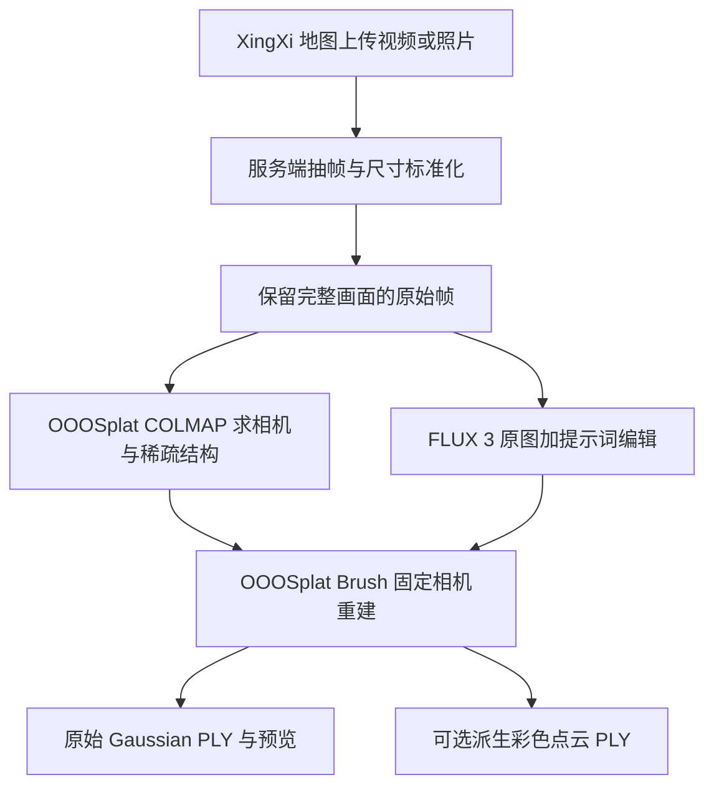

# XingXi：FLUX 3 预处理与 OOOSplat 重建融合方案

> 本文随 `feat/ui-redesign` 导入，其中既有验证记录属于原分支；本次工作区整合结果见[地图分支整合](map-ui-redesign-integration.md)。

日期：2026-10-16；2026-10-17 更新：已实现可选RGB提示词编辑路径并完成16图真实GPU联调，使用与配置见 [FLUX3 预处理接入](FLUX3_PREPROCESSING.md)。本文保留最初设计背景；Alpha增强、可选RGB派生下载等未实施项不因本次接入视为完成。

## 1. 结论与默认边界

采用 **XingXi 上传 → 服务端抽帧/尺寸标准化 → 原始完整画面求相机 → FLUX 3 提示词编辑 → 组装训练集 → OOOSplat/Brush 重建 → Gaussian 预览和下载**。

按用户本轮调整，移除训练前图像/相机与跨视角一致性检查。FLUX 处理完成后，使用既定帧映射和相机数据直接进入训练，不因拱券、台阶或轮廓变化增加拒训、暂停或人工审批。命名和尺寸变换由数据准备步骤直接完成，不另设检查阶段。

使用目标以整体展示和重建使用为准：用户接受 FLUX 对主体局部结构、轮廓或纹理的重绘，也接受去除遮挡时由模型补全表面。此类编辑结果可直接作为重建输入，不作为训练或使用限制，不增加一致性检查。

原图负责几何依据，FLUX 负责图像编辑。两路素材始终保留，不能把 FLUX 重绘图替换为“实测原图”。参考反重力 SOP 的“大场景定姿态后训练主体”结构，但不直接照搬其 SAM 2.1 步骤。

已读取 Work 会话「部署 FLUX 3 Image Klein」中用户的要求：“不要自动提取，只使用提示词，修改与编辑交给模型”。因此默认方案为 `flux3_rgb_subject_v1`：只调用原图与提示词编辑，不自动加入 SAM、分割、蒙版或后期抠像。该方案交付经过生成编辑的 3DGS，不能承诺背景完全消失或真实透明纯主体。

若后续选择严格按 SOP 做透明纯主体，则另启 `flux3_alpha_subject_v1` 增强方案，必须取得可靠 Alpha/mask；这属于另一种处理配置，不在默认流程偷偷启用。



图中是数据依赖分支；首版实际按阶段顺序执行，不新增 GPU 资源检查、门禁或训练队列。

## 2. 已核对的实际部署与证据

| 项目 | 本轮核对结果 | 接入方式 |
| --- | --- | --- |
| FLUX 主模型 | `flux3_image_klein_sd_bf16.safetensors` | 复用已部署蒸馏 BF16 权重 |
| 文本编码/VAE | `qwen3vl_4b_bf16.safetensors` / `flux2-vae.safetensors` | 复用现有 ComfyUI 节点 |
| 服务 | ComfyUI `0.41.0`，服务器 `127.0.0.1:18188` API 正常 | SSH 进入服务器后，由远端编排器调用本机 HTTP |
| FLUX 目录 | `/data/yuyuan/a2g/flux3-klein-deploy-20261016-c3e9813c` | 原生独立 Python 环境；Docker 是备用包，不是当前运行方式 |
| 图像编辑配置 | 原图参考、约 2MP、16 步、CFG 1、Euler/simple、`denoise=1` | 现有白底编辑没有调用提示词扩写器 |
| 设备记录 | 服务记录固定 GPU 3 UUID，内部显示 `cuda:0` | 不修改现有绑定，不把历史显存快照当作当前余量 |
| OOOSplat | `splatstudio generate --help` 成功 | 保留旧端到端入口作为兼容路径 |
| 重建引擎 | `engines/ffmpeg`、`ffprobe`、`colmap`、`brush_app` 存在 | 新融合流程分阶段调用现有引擎 |
| Brush 参数 | 实机支持 `--match-alpha-weight`、`--max-splats`、生长与导出参数 | 训练参数写入任务快照 |
| SOP 实验产物 | 服务端 `cup_sam2`、`creatine_sam2` 中均有原始 `final.ply` 与派生彩色 PLY | 仅证明历史产物存在，本轮未重新验收其重建质量 |

接口/部署快照见 [只读核验 JSON](../reports/integration/2026-10-16/flux3-ooosplat-plan/deployment-verification.json)。本轮未调用 `/prompt`、未启动训练、未停止或重启模型服务。

Work 的永安桥实测是两张独立 RGB 编辑图，均为 1072×1920；其记录指出侧面拱券、比例、视角与砌石有推测重绘。按用户确认的整体展示与重建用途，这些变化属于可接受的模型编辑，两张处理图可按帧清单纳入重建输入。此处保留为编辑效果与格式的历史记录，不作为任务启动门禁或使用限制。源记录位于 Work 部署目录的 `outputs/永安桥-白底处理/处理说明.md`。

## 3. 默认融合流程

### 3.1 保存原件，建立唯一任务与帧清单

继续使用当前地图管理员入口、上传限额、SSH 配置、任务 UUID 和持久记录。任务快照增加 `pipeline_profile`、提示词/工作流哈希、模型锁定版本和阶段清单。

视频先用现有 FFmpeg 抽帧。SOP 的 120–150 帧可作为完整环拍的起始配置，不能由帧数直接推断重叠率足够；同时记录实际抽取数、时间戳、模糊和重复情况。照片保持独立帧 ID 和来源映射。

先将参与两路处理的图片变换到模型支持的固定像素网格，再用这一套完整画面解算相机。保留原文件、EXIF 方向处理与缩放/裁剪变换，不对每帧各自重新构图。视频统一尺寸；混合相机照片按各自相机记录处理。

每张帧记录：`frame_id`、`source_sha256`、原始尺寸、标准化尺寸、像素变换、时间戳、原图路径、预处理输出路径、ComfyUI prompt ID、实际输出尺寸和哈希。

### 3.2 用完整原始画面求相机，不先抹掉背景

复用 OOOSplat 所带 COLMAP，在标准化的完整画面上做特征、匹配与位姿求解，保存真实注册数、未注册帧、重投影信息、相机与稀疏点。

弱纹理主体仍需要背景辅助定位，FLUX 的白底和推测结构不参与这一步。只把确实注册成功的视图纳入对应训练集，不能把 140 张输入一律写成 140 张有效相机；已有药罐记录实际为 134/140。

当前公开 `splatstudio generate` 接口会走端到端流程，没有在帮助中发现只跑 COLMAP 的阶段选项。新实现应直接调用同一部署的 COLMAP 引擎、复用已有相机缓存，并按实际镜头模型决定是否需要去畸变。不要先完整训练一遍，再拿相机重新训练一遍；也不要编造 `--only-colmap` 参数。

### 3.3 FLUX 3 执行原图加提示词预处理

远端编排器在同一服务器上调用现有 ComfyUI。输入放入其固定 `data/input/xingxi/<job_id>/`，输出使用独立任务前缀；按 `/history/<prompt_id>` 返回的文件记录收集结果，不猜测最近输出文件。

复用已验证的 `LoadImage → ReferenceMultiLatent → KSampler → VAEDecode → SaveImage` 编辑链，固定模型、16 步、CFG 1 与采样器，记录每帧 seed 和输出哈希。固定 seed 是复现手段，不保证多视角结构一致。

实机 `ReferenceMultiLatent` 支持 `keep resolution`。新流程配置为保持标准化输入尺寸；需要固定缩放或裁剪时，在数据准备阶段按既定变换更新相机内参，不另设尺寸或投影检查阶段。

默认提示词以保留主体身份、整体构图与视角为编辑目标，移除背景和遮挡物，允许模型重绘局部结构、轮廓和纹理，并补全被遮住的石材表面。上述内容用于指导模型，不构成训练前检查或拒训条件。生成编辑记录保存在任务元数据中，编辑完成后直接进入数据组装与训练。

官方建议使用 Prompt Upsampler；当前 Work 编辑工作流未调用它。首轮应把当前已验证工作流冻结为基线。若增加扩写，可在批次前生成并核对一次固定指令，再保存扩写结果；需要单独验证，不能声称“长提示词等价于官方扩写”。不为每帧随机改变编辑目标。[FLUX 官方说明](https://github.com/black-forest-labs/flux-3-image-klein)

### 3.4 直接组装训练集

按任务建立时保存的 `frame_id` 映射，将 FLUX 输出写入 `dataset/images/`，将已求解的相机与稀疏模型放入 `dataset/sparse/0/`。命名、方向和固定尺寸变换由数据准备步骤按既定配置完成。

组装完成后直接调用 Brush，不增加图像/相机对齐验证、跨视角结构判断、轮廓检测或因视觉变化触发的失败回退。原图和编辑图均保留供后续查看，查看结果不影响训练启动。

### 3.5 OOOSplat/Brush 执行融合重建

调用已有 `/data/yuyuan/ooosplat/engines/brush_app` 及其运行库 wrapper，不替换部署，不安装另一套重建引擎。

`high` 的起始候选参数继承 SOP：30,000 步、最大分辨率 2000、点数上限 500,000、生长梯度阈值 0.00003、选择比例 0.25、停止生长迭代 25,000；完整命令和 wrapper 注入参数均写入快照，避免重复参数覆盖。`fast`/`balanced` 的融合配置需在实施时明确映射，不沿用名称就假称与旧 CLI 质量档完全等价。

默认 RGB 方案不使用 `--match-alpha-weight 0.2` 来宣称透明约束生效。实机帮助明确该参数针对透明输入，普通白底 RGB 不提供所需 Alpha。官方 Brush 同时区分透明图像与独立 masks 的处理语义。[Brush 官方说明](https://github.com/ArthurBrussee/brush)

FLUX 和 Brush 在任务内按阶段顺序执行；模型释放只针对本次所用服务，并遵守该服务真实支持的接口及共享使用情况。不新增 GPU 余量探测、占卡门禁、资源排队或自动抢占。ComfyUI 自带 prompt 执行机制不扩展成新的 XingXi GPU 调度器。

### 3.6 结果按实际类型交付

| 产物 | 用途 | 保留字段与限制 |
| --- | --- | --- |
| `final.ply` | 地图 Spark 高斯预览、原始结果下载 | 保留 Gaussian scale、rotation、opacity、SH 等原始字段 |
| `colored_points.ply` | 可选普通点云兼容下载 | 从 SH 的 DC 分量派生颜色；不保留完整视相关外观，不能替换高斯预览文件 |
| 原图/编辑图对照 | 可选查看预处理效果 | 清楚区分输入观测与模型生成，不作为训练门禁 |
| `pipeline_result.json` / manifest | 复现、阶段恢复、完整性校验 | 原件/模型/工作流/参数/输入输出哈希与相机映射 |

原有 GLB 入口继续使用现有资产，不把彩色点云重命名为 GLB。新结果保持“生成处理、待核验”，不自动改地图坐标、合并实体、替换正式模型或发布知识。

## 4. 与 SOP 的差异和必须纠正的结论

| SOP 原有思路/表述 | 融合处理 |
| --- | --- |
| 完整画面先求相机 | 保留，是弱纹理主体的重要几何依据 |
| SAM 2.1 产生真实 Alpha | 默认由 FLUX RGB 编辑替代图像处理，但不声称两者具有相同透明训练能力 |
| 全部相机“100%准确闭环” | 记录真实注册数、轨迹和误差，注册成功不等于位姿绝对准确 |
| 50 万点全部属于主体 | `max-splats` 是上限；实际点数可更低，点数不代表细节正确或背景已清空 |
| Alpha 约束使背景误差恒为零、绝不长点 | 这是损失约束，不是对所有背景点的数学禁止；结果仍需检查 |
| SH 转 RGB 作为最终高斯模型 | 原始 Gaussian 保留；RGB 点云只是兼容派生物，不替代 Gaussian 渲染 |

若后来允许 Alpha 增强，流程才追加分割/时序追踪与 RGBA 组装。对于可信几何分支，优先保留原始观测 RGB；FLUX 补画纹理另存生成分支。对于白底生成分支，按实际编辑图生成 mask，按所选配置处理稀疏背景初始化点，再应用 Alpha 损失；不增加跨视角检查门禁，也不据此承诺“100%纯净”或“必达50万点”。[SAM 2 官方接口](https://github.com/facebookresearch/sam2)

## 5. 接入现有 XingXi 的改动范围

当前 SSH/SFTP、管理员鉴权、CSRF、大文件流式上传、数据库任务记录和 Spark 预览可以复用。后续只扩展现有任务执行链：

| 位置 | 计划变更 |
| --- | --- |
| Gateway 重建配置 | 增加服务端 FLUX 地址、部署路径、固定工作流版本、融合 profile；不把凭据送到浏览器 |
| 任务快照 | 增加每阶段状态、重试 attempt、ComfyUI prompt IDs、帧映射、模型与工作流哈希 |
| `runner.py` | 从单一 `generate` 子进程改为分阶段编排；旧任务仍按 legacy 模式读取 |
| 结果校验 | 当前依赖原生 `project.json`；新分阶段产物使用版本化 `pipeline_result.json`，校验实际产物后提交完成，不伪造原生 OOOSplat 项目成功记录 |
| 地图面板 | 在原面板显示原图定姿、预处理 n/N、训练、导出与对应错误；不增加训练前检查或独立管理系统 |
| 下载 | 维持现有受保护 `final.ply`，派生点云另设白名单 artifact 类型 |

对外主状态继续兼容 `transferring/running/completed/failed/cancelled`，细阶段进入 `stage` 与阶段元数据。训练进度必须来自真实日志，上传 100% 不是训练 100%。

### 恢复与取消不能照搬本地子进程语义

ComfyUI 是独立常驻服务，杀掉 SSH 编排进程不会取消已提交 prompt。必须持久化每张图的 prompt ID，刷新时读其 history，不重复提交已完成图。

`client_id` 不是默认幂等键。若 `/prompt` 已受理但确认包丢失，应根据任务关联元数据与执行记录核对，不确定时保留“连接待核对”，不盲目再发一张。

取消时停止后续阶段，仅操作本任务 prompt。若当前版本不支持按精确 prompt ID 中断正在运行的推理，允许当前图结束并丢弃下游启动，不能调用影响整个共享服务的全局 interrupt。Brush 继续只终止本任务创建的进程组。

## 6. 建议实施顺序与验收

1. **先做融合适配与小样本联调**：冻结原图、工作流、提示词和 seed；用少量视图走通 SSH → ComfyUI → Brush、取消和断线恢复。软件联调不在业务流程中增加图像/相机或跨视角检查阶段。
2. **再做一个完整环拍批次**：按清单处理真实抽出的120–150帧，统计实际注册与有效视图，不用已有两张永安桥独立白底图冒充多视角验证。记录全部阶段耗时；两张 Work 图片约33秒/张不能直接保证整段视频的总耗时。若只按该样本线性粗算，120–150帧的图像处理约66–83分钟，尚不含相机解算和训练；这是容量估算，不是整批实测。先用小批次确定帧数与分辨率，再决定是否处理全量。
3. **需要严格透明纯主体时再选择Alpha增强**：当前“只提示词”默认配置不改变，增强方案需单独明确选择和配置。

功能验收以任务流程完成、产物可下载和浏览器能渲染为准，不增加几何或跨视角一致性检查。没有实际新运行证据，不将本文标为融合部署已完成。

## 7. 最终产物与地图预览适配

### 7.1 推荐路线与现状

地图统一支持 GLB 网格、Gaussian 高斯、RGB 点云三类资产。首选保留 Brush 原始 `final.ply`，复用已接入的 Spark 高斯查看器，不先转换为 GLB。已有普通彩色 PLY 可以单独用点云查看器显示，不需要为了适配地图重新训练。

当前代码已具备两套预览：

- `glb-viewer-slot.tsx` / `model-viewer.tsx`：读取现有景点 GLB，支持放大、旋转和复位。
- `gaussian-viewer.tsx`：使用 Spark，支持原始 Gaussian PLY、旋转缩放、聚焦主体、完整范围和失败重试。当前挂在管理员 `reconstruction-panel.tsx` 的任务记录中，不是普通用户可直接访问的统一地图资产入口。

因此主要改动是统一资产入口、类型分发和结果登记；不需要重新制作整个地图。

### 7.2 明确区分三种产物

| 产物 | 地图渲染器 | 处理方式 |
| --- | --- | --- |
| Brush 原始 `final.ply`，含 Gaussian scale/rotation/opacity/SH | 现有 Spark / GaussianViewer | 作为主要三维预览与原件下载 |
| `*_colored.ply`、`colored_points.ply`，仅坐标/RGB/Alpha | 新增 PointCloudViewer | 用 Three.js PLYLoader + Points 显示彩色点云，提供点大小和背景控制 |
| 现有 `.glb` | 现有 ModelViewer | 保留现有网格模型预览 |

本轮只读文件头确认：本地 `outputs/creatine_sam2_pure_subject.ply`（487,474 点）、`cup_sam2_500k_colored.ply`（155,770 点）和 `cup_colored.ply`（500,000 点）均只有 `x/y/z/red/green/blue/alpha`，不是保留完整高斯属性的文件。它们可以通过新增点云渲染分支使用；若采用高斯预览，应登记对应重建任务保留的原始 `final.ply`。

普通 RGB 点云不能只改扩展名变成 GLB 或恢复已经丢弃的高斯参数。页面按资产类型选择渲染器，不单凭 `.ply` 扩展名判断。这里属于格式适配，不增加用户已取消的结构或跨视角检查。

### 7.3 训练完成后登记地图资产

新增统一地图资产记录，精确关联 `point_id` 与 `entity_id`，包含来源 `job_id`、资产版本、产物类型、预览地址、原件地址、封面与默认视角。已有七个 GLB 作为现有资产兼容保留。

建议的资产元数据示例（字段为待实施契约，不是已经新增的接口）：

```json
{
  "id": "model-yongan-reconstruction-v2",
  "point_id": "pt-yongan-bridge",
  "entity_id": "entity-bridge-yongan",
  "kind": "gaussian",
  "format": "ply",
  "preview_url": "/api/map/model-assets/model-yongan-reconstruction-v2/preview",
  "download_url": "/api/map/model-assets/model-yongan-reconstruction-v2/original",
  "poster_url": "/api/map/model-assets/model-yongan-reconstruction-v2/poster",
  "source_job_id": "<reconstruction-job-id>",
  "view_transform": {
    "rotation_quaternion": [1, 0, 0, 0],
    "scale": 1
  }
}
```

`kind` 分为 `gaussian`、`point_cloud`、`mesh`；同是 PLY 也可明确路由。训练完成后生成资产记录和封面，关联上传时选择的地图点位。点位可保留多次成果，支持直接切换展示版本和设为默认，不新增质量审核环节，也不改变知识发布协议。

已有结果可通过“导入模型”登记：导入本地 PLY/GLB，或由受控后端登记该任务的服务端产物；完成点位关联后即可打开。不要要求用户为已有产物重新执行整条训练流程，也不向浏览器暴露任意 SSH 路径。

### 7.4 地图界面调整

2026-10-17 彩色兼容子阶段已实施，使用方式见 [地图彩色 PLY 预览](COLORED_PLY_MAP_PREVIEW.md)：当前点位可临时打开本地 PLY，任务产物也能按 Gaussian/RGB 分流。下列统一资产登记、版本选择、普通用户远程资产接口和地图标记联动仍属于后续方案，不能将本地临时打开视为已完成全部资产系统。

将现有 GLB 页签扩展为统一“三维预览”。桌面继续使用右侧详情面板，移动端继续使用底部面板；提供版本选择、封面、按需加载和全屏查看。

统一组件可规划为：

```text
MapModelViewer
├── kind=mesh        → 现有 ModelViewer
├── kind=gaussian    → 现有 GaussianViewer
└── kind=point_cloud → 新增 PointCloudViewer
```

“影像重建”继续承担管理员上传、日志和取消等任务管理；预览与任务管理分开。当前重建 API 连读取和下载都仅限管理员，单纯显示一个普通用户按钮仍会返回403。需要新增与地图模型可见范围一致的读取/下载接口，普通登录用户可以查看已开放的点位资产，管理员继续控制训练与展示版本，不直接放开整个任务管理 API。

地图标点的3D标记应来自该点位可读资产，而不再只依赖硬编码 GLB 列表。有多个版本时打开默认资产；不要按相同名称猜测关联点位。保留原 OSM 底图和署名，不改地图坐标。

### 7.5 查看器增强

- 高斯与点云都支持拖动旋转、缩放、复位、聚焦、自动旋转与全屏。放大时复用一个活跃实例，不额外加载第二份大文件。
- 将 GaussianViewer 当前固定的 X 轴翻转改成按资产读取 `view_transform`；旧任务继承现有方向约定。根据模型中心和范围初始化相机，必要时保存默认视角。仅调整显示变换，不修改原始文件。
- 支持浅色/深色背景和实际加载进度。RGB 白底图片参与训练，不代表所得3D文件的背景必须永久为白色，最终由渲染背景与产物内容共同决定。
- 当前高斯预览先整体下载到内存，任务面板对超过256 MiB的文件只显示下载。后续保留原件，另提供轻量预览资产；可选 Spark 支持的 SPZ，并按设备降低绘制分辨率。压缩减少传输，不等于消除解码与显存开销，移动端的轻量资产应单独配置。
- WebGL不可用或加载失败时显示封面与原件下载，不让地图整体报错。按需加载，切点位或关闭面板时释放渲染资源。

[Spark 官方格式与加载接口](https://sparkjs.dev/docs/splat-mesh/)支持 Gaussian PLY、SPZ 等高斯格式；现有 GLB 继续通过 [model-viewer](https://modelviewer.dev/) 显示。

### 7.6 优先改动的位置

| 位置 | 计划变更 |
| --- | --- |
| 后端结果 manifest / 地图资产接口 | 同时登记原始 Gaussian、派生点云、封面及点位关联；提供按资产读取的权限与下载 |
| `core/map/model-assets.ts` | GLB 专用描述扩展为带 `kind` 的统一资产协议，兼容现有资源 |
| `map/page.tsx` | 三维页签与地图3D标记统一读取资产；模型可见性与管理员重建入口分离 |
| `reconstruction-panel.tsx` | 完成任务可直接打开对应地图资产，复用统一查看器 |
| `gaussian-viewer.tsx` | 支持资产视角、方向、全屏、自动旋转、加载进度与预览资源类型 |
| 新 `point-cloud-viewer.tsx` | 适配现有 RGB PLY 产物，提供相同基础操作 |
| 新 `map-model-viewer.tsx` | 按资产类型分发渲染器，统一状态、操作与单实例生命周期 |

### 7.7 是否把模型直接叠到地图地表

首版推荐“点位选中 → 三维预览面板/全屏”，这已经能完整展示成果，模型不需要具备真实地理尺度。

若后续要求模型与道路、建筑直接叠加，则另外实现 MapLibre 自定义三维图层，配置经纬度锚点、高程、朝向与比例。COLMAP局部坐标不能直接当作经纬度或真实米制尺寸；这些是叠图显示参数，不是新增结构质量检查。该功能单列后续阶段，不作为普通预览的前置条件。

## 8. 来源

- 本项目 [反重力纯主体 SOP](3dgs-pure-subject-reconstruction-sop.md)、`scripts/run_sam2_{cup,creatine}.py` 与 `scripts/train_{cup,creatine}_sam2.py`。
- Antigravity 本地摘要库中对应 SOP 的会话 `999a9585-7693-42b9-b555-295db72807d7`，chunk 7；其叙述作为历史记录，不替代本轮质量证据。
- Work 会话「部署 FLUX 3 Image Klein」，以及该会话目录下 `outputs/flux3-klein-deploy/` 的部署说明、白底试验核验、模型锁定与实际 API 图。
- Work 目录下 `outputs/永安桥-白底处理/处理说明.md`，含两张独立 RGB 输出及侧面结构重绘记录；本融合方案按用户确认将重绘视为可接受编辑。
- [FLUX 官方参考实现](https://github.com/black-forest-labs/flux-3-image-klein)、[官方 ComfyUI 指南](https://docs.comfy.org/tutorials/flux/flux-3-klein)、[Brush 官方文档](https://github.com/ArthurBrussee/brush)、[SAM 2 官方接口](https://github.com/facebookresearch/sam2)。服务器上具体参数以本轮已核验的二进制帮助与节点接口为准。
