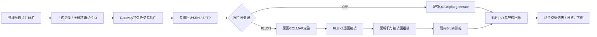

# 12026 服务器地图：点位与模型链路

2026-10-21：已在 `/data/laikai/deer-flow` 的现有部署启用。分支来源为 `Lai-Kai/XingXi` 的 `feat/ui-redesign`，提交 `2f952d5f`。服务器此前已导入对应地图代码；本轮补充运行环境、专用 SSH 认证、上传代理与正式入口验证，保留现有路线、时间轴和其他业务页面。

## 使用入口

通过既有 SSH 隧道打开 `http://localhost:12026/workspace/map`，以项目管理员登录。

1. 点击「创建点位」，在地图上选位置，填写名称并保存。
2. 点击「创建模型」，选择刚创建的点位。
3. 选择「上传影像重建」或「接入已有模型」。重建支持至少两张图片或一个视频；已有模型支持彩色 RGB/RGBA 点云 PLY、原生 Gaussian PLY 和内嵌资源的 GLB。
4. 重建选择精度；默认使用原图，可选「FLUX3 图片编辑」并填写提示词。
5. 在点位的「影像重建」查看进度；完成后进入「三维预览」切换结果和下载。重新提交同一请求不会重复训练；另建请求可保留多个历史模型。

自建点位与模型独立于知识 Release、Evidence 和图谱。写入继续要求现有的项目管理员角色；本轮仅按用户明确授权提升了指定账号，未重置密码或修改其他账号。

## 实际执行链



浏览器只访问项目 API。Gateway 以部署账号 `laikai` 通过 `127.0.0.1:22` 连接同一主机，不复制其他用户的 SSH 密码。训练复用 `/data/yuyuan/ooosplat` 的既有可执行文件；FLUX 复用现有 ComfyUI 的 `127.0.0.1:18188`。

没有新增 SAM、分割、抠像、结构拒训、GPU 排队或全局中断。模型编辑仍是 RGB 提示词编辑，白底不等于透明 Alpha。

## 部署配置

使用源码所属账号运行，避免产生 root 所属的业务文件：

```bash
sudo -u laikai /data/laikai/deer-flow/backend/.venv/bin/python -B \
  /data/laikai/deer-flow/scripts/configure_map_reconstruction.py \
  --root /data/laikai/deer-flow \
  --flux-root /data/yuyuan/a2g/flux3-klein-deploy-20261016-c3e9813c
```

脚本先确认引擎与严格主机密钥校验下的 SSH/SFTP 可用，再更新私有 `.env`。它创建专用 Ed25519 密钥，将公钥以 `from="127.0.0.1",restrict` 登记到部署账号的 `authorized_keys`。不会改写原有密钥。配置、私钥和可信主机公钥位于 `backend/.deer-flow/reconstruction-worker/ssh/`，目录权限 700，私有文件 600；任务目录为该 worker 下的 `jobs/`。

设置项包含 `XINGXI_OOOSPLAT_SSH_CONFIG`、`XINGXI_OOOSPLAT_KNOWN_HOSTS`、`XINGXI_OOOSPLAT_REMOTE_ROOT`、`XINGXI_OOOSPLAT_EXECUTABLE`、`XINGXI_OOOSPLAT_ENGINE_DIR`，及可选的三个 FLUX3 设置。私有配置和密钥不进入 Git 或浏览器响应。

本轮按现有锁文件仅补装 `paramiko==4.0.0`、`pynacl==1.6.2`、`invoke==3.0.3`，其余依赖未升级。FLUX 输入只需额外允许 `laikai` 写入既有 `data/input/xingxi` 子目录；输出继续由原 ComfyUI 账号生成并供只读获取。原 ACL 已在引擎工作目录备份。

Gateway 重启后读取配置；ComfyUI 由原维护流程管理，创建任务不负责重启或抢占该服务。

```bash
sudo -u laikai bash /data/laikai/heikesong/deerflow-native/start.sh stop
sudo -u laikai bash /data/laikai/heikesong/deerflow-native/start.sh start
sudo -u laikai bash /data/laikai/heikesong/deerflow-native/start.sh status
```

主机反代模板位于启动器目录，版本化补丁见 [native-map-reconstruction-upload.patch](patches/native-map-reconstruction-upload.patch)。仅两个模型入口有独立额度：影像重建 2 GiB 加 16 MiB multipart 余量；已有模型 256 MiB 加 16 MiB 余量。后端仍检查真实大小；文献上传继续使用原配置。只修改反代时运行 `start.sh reload-proxy`。

## 本轮验证

- 77 项后端专项、63 项地图单元、3 项部署脚本回归、15 项主机反代回归通过。
- 正式 `12026` 登录、地图选点命名、重复请求幂等、创建模型弹窗、可编辑 FLUX 提示词、手机端入口通过真实浏览器验证。
- RGB PLY 上传、切换与三维场景就绪；135,920,656 字节 GLB 上传成功，超过原反代限制；完整 SHA 和 Range 206 读取通过。
- 使用已有乐高 16 图，以 fast 档完成真实 FLUX3→Brush 链路。16 图全部处理，8,000 步，Brush 退出码 0、耗时 52.024 秒；输出 18,250 个高斯点、4,308,550 字节，59 个 float 字段，颜色字段与有限数值检查通过。
- PLY SHA-256：`bb7e3f51cf60fc2a8dae4e3fa9a2886a41411ed9b62c9e545d42c17741e2d11a`。正式地图直接从该任务的受保护模型接口加载，高斯预览就绪，浏览器无页面异常；相同素材和请求 ID 重传仍返回原任务。
- 验收后移除本轮 2 个临时点位与 3 条模型/任务记录，正式地图恢复原有内容；训练产物与回执另行保留。视频真实 GPU 链路未在本轮重跑。本轮证明部署链路可用，不是独立几何精度或泛化验收。

备份目录为 `/data/laikai/heikesong/deerflow-native/.runtime/map-chain-20261021T063114Z/`，包含修改前数据库、私有配置与原文件；该目录不公开、不提交。地图的历史分支导入记录见 [map-ui-redesign-integration.md](map-ui-redesign-integration.md)。
