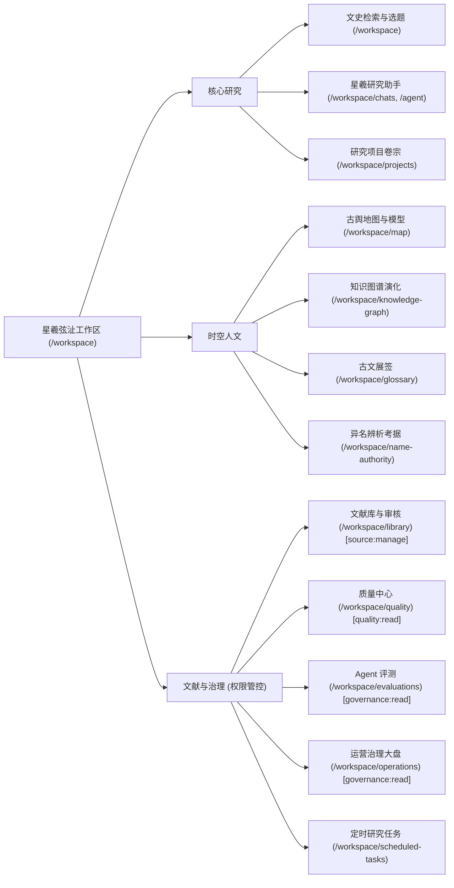

# 02 — Gemini 设计规格

Design status: ready-for-implementation
Design version: v1.1.0 (含视觉资产与艺术画廊)
Design owner: Gemini
Based on commit: 111f59dfa07c7c52ad67d7eb435c35cc8db2b385
Last updated: 2026-10-15

---

## 1. 设计方向与产品依据

### 1.1 产品定位与核心用户任务
- **产品定位**：面向吴文化与木渎地域文史研究的可信智能体工作台（星羲弦沚）。以权威地方志、碑刻、档案与历史考据材料为事实底座。
- **目标用户**：
  1. **文史学者与地方志研究者**：需要长文阅读、句读考据、严谨溯源（Evidence）、异名对照与历史时空考证。
  2. **文化管理与审核人员**：需对 OCR 原文、清洗版本、关系抽取、知识图谱及地图要素进行高精度的多级核验（通过/争议/驳回）。
  3. **地域文化爱好者与研学访问者**：浏览今日文史选题、探索二维古舆地图与三维名胜模型（GLB）、研读历史人物时空轨迹。
- **核心体验关键词**：`典雅信实`（严谨考据）、`水润墨韵`（吴文化水乡雅致）、`清澈结构`（工作台高信息密度）、`证据可循`（全链路溯源）。

### 1.2 两个设计方向对比与取舍

| 维度 | 方向 A（推荐）：典雅方志·人文水墨（Wu-Heritage Scholar） | 方向 B：空间数字·档案工作台（Spatial-Digital Archive） |
| :--- | :--- | :--- |
| **设计隐喻** | 苏州园林“粉墙黛瓦、碧水翠竹”，古籍方志宋椠经折、朱砂批校与石青水绿 | 现代 GIS 遥感、冷灰工程化控制台、高对比度数据密集仪表盘 |
| **主基调色** | 素宣浅灰白底色、墨色主字、沧浪水碧（Teal-Slate）作为功能主色，点缀朱砂印与古松石 | 冷纯白底、纯黑字、科技深蓝（Tech Blue）、冷金属灰边框 |
| **长文阅读** | 专为中文文史优化的行高（1.75）、衬线字阶梯引导、柔和的底色减缓视觉疲劳 | 偏现代等宽与无衬线混排，信息密度极高，长时间阅读易疲劳 |
| **证据呈现** | 典雅的边栏“经折夹注”浮层，书名卷目清晰如线装书题签，置信度用古玺色阶表达 | 纯矩形数据卡片，标签式密集罗列，文化沉浸感较弱 |
| **管理审查** | 审核状态（通过/争议/驳回）结合朱砂、石绿与藤黄传统印章色，严肃而不失文化质感 | 标准红黄绿交通灯配色，视觉对比生硬 |
| **设计结论** | **推荐采用方向 A**：兼具文史工具的文化底蕴与现代化工作台的高效交互，降低冰冷感。 | 留作未来底层引擎运维或纯技术监控页面的参考备选。 |

---

## 2. 信息架构与全局布局

### 2.1 全局导航与功能层级对应
统一星羲单智能体架构，取消所有通用 Agent 广场入口。导航结构如下：



### 2.2 响应式布局架构 (1440px / 1024px / 390px)

1. **桌面端（1440×900 宽屏基准）**：
   - **全局侧栏（Sidebar）**：宽度 260px，可折叠至 64px 紧凑图标栏。左上角为“星羲弦沚”印记徽标，下部收纳系统偏好与用户身份。
   - **主工作区（Main Stage）**：采用两栏/三栏自适应模式。
     - 检索/首页/文献库：居中最大宽度 1280px，保留呼吸边距。
     - 聊天助手：中央沉浸对话流（宽 768px~880px），右侧常驻可伸缩“考据出处与证据面板”（Evidence Inspector，宽 380px）。
     - 地图与图谱：全屏视口铺满，左上悬浮层级筛选器，右侧浮层展示选中实体/模型详情。
2. **平板端（1024×768 承上启下）**：
   - 侧栏默认折叠为 64px 图标导航；右侧证据抽屉默认收起，点击引用胶囊以浮动 Sheet（抽屉）滑出，宽度 420px。
3. **移动端（390×844 / 360×800 触控优先）**：
   - 顶部提供固定 48px `BusinessMobileHeader`，包含汉堡菜单触发器、当前页面标题与轻量搜索入口。
   - 底部提供触控手势抽屉（Bottom Sheet），地图与图谱的详情面板均以半屏/全屏手势上滑呈现。
   - 所有触控目标尺寸保证 $\ge 44 \times 44\text{px}$。

---

## 3. Design Token 体系与 Tailwind 4 映射

### 3.1 核心调色板（OKLCH 与 Hex 精确值）

为兼容前端已有 `globals.css` 中基于 OKLCH 的 Tailwind 4 内联主题，同时收拢散落在各页面的硬编码十六进制色值，建立如下两套语义调色板：

#### 浅色主题（Light Theme：素宣纸韵·沧浪碧波）
| 变量名 | OKLCH 数值 | 等效 HEX (示意) | 语义与视觉用途 |
| :--- | :--- | :--- | :--- |
| `--background` | `oklch(0.985 0.006 195)` | `#f8faf9` | 全局大底色，如温润宣纸，微带江南水墨冷翠底蕴 |
| `--foreground` | `oklch(0.220 0.018 205)` | `#1c282a` | 正文文字，如松烟墨色，清晰深邃且不刺眼 |
| `--card` | `oklch(1.000 0.000 0)` | `#ffffff` | 浮层/卡片表面色，粉墙如雪 |
| `--card-foreground` | `oklch(0.220 0.018 205)` | `#1c282a` | 卡片内正文 |
| `--popover` | `oklch(1.000 0.000 0)` | `#ffffff` | 下拉菜单、Tooltip、弹出窗基底 |
| `--popover-foreground`| `oklch(0.220 0.018 205)` | `#1c282a` | 弹出层文字 |
| `--primary` | `oklch(0.420 0.080 195)` | `#176d79` | **星羲主色（沧浪水碧）**：主按钮、选中高亮、品牌徽标 |
| `--primary-foreground`| `oklch(0.990 0.002 195)` | `#f5fafb` | 主按钮文字 |
| `--secondary` | `oklch(0.940 0.015 195)` | `#e2edf0` | 次级按钮背景、弱选中背景 |
| `--secondary-foreground`|`oklch(0.300 0.050 195)`| `#1f4e56` | 次级按钮文本 |
| `--muted` | `oklch(0.960 0.008 195)` | `#edf3f4` | 占位底色、分割区背景、代码块背景 |
| `--muted-foreground` | `oklch(0.520 0.020 205)` | `#5c7075` | 次级辅助信息、时间戳、文献注记 |
| `--accent` | `oklch(0.910 0.030 195)` | `#d5e7ea` | 悬浮高亮、激活 Tab 胶囊背景 |
| `--accent-foreground` | `oklch(0.250 0.060 195)` | `#144b54` | 悬浮文字颜色 |
| `--border` | `oklch(0.890 0.012 195)` | `#cedbd8` | 统一边框色，替换所有 `#cfdcde`、`#d2dfe1` |
| `--input` | `oklch(0.890 0.012 195)` | `#cedbd8` | 输入框边框 |
| `--ring` | `oklch(0.420 0.080 195)` | `#176d79` | 全局键盘 Focus Ring 焦点框 |
| `--sidebar` | `oklch(0.970 0.010 195)` | `#f1f6f7` | 左侧边栏底色 |
| `--sidebar-foreground`| `oklch(0.240 0.020 205)` | `#213033` | 侧栏文字 |
| `--sidebar-border` | `oklch(0.900 0.012 195)` | `#d3e0df` | 侧栏分割线 |

#### 审核状态与文史语义专色（Semantic & Heritage Tokens）
| 语义分类 | 变量名 | 推荐 OKLCH / 色值 | 背景 / 边框 / 文本组合 (Light) | 用途说明 |
| :--- | :--- | :--- | :--- | :--- |
| **已通过 / 真实证据** | `--heritage-approved` | `oklch(0.55 0.14 148)` | `bg-[#eaf5ee] border-[#b7dfc7] text-[#1e663d]` | 经方志考证属实、审核通过、证据链完备 |
| **有争议 / 存疑待考** | `--heritage-disputed` | `oklch(0.65 0.16 85)` | `bg-[#fdf7e7] border-[#f4db9b] text-[#865d14]` | 异名分歧、坐标近似（approximate）、文献记载互异 |
| **已驳回 / 伪造错误** | `--heritage-rejected` | `oklch(0.55 0.18 28)` | `bg-[#faecec] border-[#f2bebe] text-[#9c2d2d]` | 考证伪托、无文献支撑、管理员驳回条目 |
| **待审核 / 草稿语料** | `--heritage-pending` | `oklch(0.55 0.04 220)` | `bg-[#edf2f4] border-[#d1dee2] text-[#4b6369]` | OCR 刚提取、种子数据未复核、待定级 |
| **古籍引文 / 专有名词**| `--heritage-citation` | `oklch(0.48 0.10 200)` | `bg-[#e8f4f6] border-[#9ec7cf] text-[#135d67]` | 正文中引用的地方志书名、卷册、正文章节 |

#### 深色主题（Dark Theme：夜墨寒潭）
- `--background`: `oklch(0.180 0.010 205)` (`#131a1b`)
- `--foreground`: `oklch(0.940 0.005 195)` (`#eef3f4`)
- `--card`: `oklch(0.220 0.012 205)` (`#1a2426`)
- `--border`: `oklch(0.300 0.012 205)` (`#2a383b`)
- `--primary`: `oklch(0.680 0.100 195)` (`#45b2c2`)
- `--sidebar`: `oklch(0.160 0.010 205)` (`#101617`)

### 3.2 字体排版体系（Typography Hierarchy）

```css
/* 中文优先的文史学者字体栈 */
font-family-serif: "Noto Serif SC", "Source Han Serif SC", "FangSong", "SimSun", serif;
font-family-sans: "PingFang SC", "Hiragino Sans GB", "Microsoft YaHei", "Noto Sans SC", system-ui, sans-serif;
font-family-mono: "JetBrains Mono", "SF Mono", Consolas, monospace;
```

| 级别 | 字体大小 (px/rem) | 行高 (Leading) | 字重 (Weight) | 适用场景 |
| :--- | :--- | :--- | :--- | :--- |
| **Display (诗文/名胜题额)** | `32px / 2.0rem` | `1.3` | Semibold / 600 | 首页标题、名胜模型全屏题签、古籍卷册首题 |
| **H1 (页面主标)** | `24px / 1.5rem` | `1.35` | Semibold / 600 | 各功能工作台页面标题、大图谱主题名 |
| **H2 (区块/卡片标题)** | `18px / 1.125rem`| `1.4` | Medium / 500 | 今日选题卡片标题、文献详情弹窗标题 |
| **H3 (小节/组件标题)** | `15px / 0.9375rem`| `1.45` | Medium / 500 | 侧栏分组名、表格列头、引文考据折叠头 |
| **Body (长文阅读/回答)** | `15px / 0.9375rem`| `1.75` | Normal / 400 | 星羲对话长文解答、史料清洗前后文本对比 |
| **Body-Dense (紧凑正文)** | `14px / 0.875rem` | `1.5` | Normal / 400 | 表格单元格内容、元数据表单、知识图谱侧边栏 |
| **Caption (元数据/注记)** | `12px / 0.75rem` | `1.4` | Normal / 400 | 页码指示（如 `21-22页`）、时间戳、OSM 版权署名 |

### 3.3 间距与圆角（Spacing & Radius）
- **基准步进**：4px / 8px 律动体系。
  - `space-1 (4px)`、`space-2 (8px)`、`space-3 (12px)`、`space-4 (16px)`、`space-6 (24px)`、`space-8 (32px)`、`space-12 (48px)`。
- **圆角规约**：
  - 微圆角（按钮、输入框、标签）：`rounded-md` = `6px`（取代原有略显突兀的过大圆角）。
  - 卡片与面板：`rounded-lg` = `10px`。
  - 模态对话框与抽屉：`rounded-xl` = `14px`。
  - 胶囊/头像：`rounded-full` = `9999px`。
- **阴影层级**：
  - 卡片微投影：`box-shadow: 0 1px 3px 0 rgba(23, 109, 121, 0.05), 0 1px 2px -1px rgba(23, 109, 121, 0.05)`
  - 悬浮/抽屉投影：`box-shadow: 0 10px 25px -5px rgba(23, 109, 121, 0.1), 0 8px 10px -6px rgba(23, 109, 121, 0.08)`

---

## 4. 公共组件设计规范

### 4.1 基础与表单组件规范

| 组件名 | 规格与尺寸 | 状态定义（Default / Hover / Focus / Disabled） | 无障碍与键盘交互 |
| :--- | :--- | :--- | :--- |
| **Primary Button** | 高度 `36px`（桌面）/ `42px`（触控）；水平内边距 `16px`；字号 `14px` Medium。 | **Def**: 背景 `--primary`，文本白；<br>**Hov**: 背景变深 `oklch(0.38 0.08 195)`；<br>**Foc**: 2px 轮廓环 `ring-2 ring-offset-2 ring-primary`；<br>**Dis**: 禁用态 `opacity-40 cursor-not-allowed`。 | 支持 `Enter` / `Space` 触发，具备明确 `aria-label`。 |
| **Research Composer (研究输入框)** | 多行自适应高度 `min-h-[110px]`；底色 `--card`；边框 `1px solid var(--border)`。 | **Def**: 边框 `--border`；<br>**Foc**: 边框高亮 `--primary`，柔和外发光；<br>**Error**: 边框变为 `--heritage-rejected`。 | 支持 `Shift+Enter` 换行，`Ctrl+Enter` 快速提交；移动端防虚焦。 |
| **Evidence Capsule (引文考据胶囊)** | 高度 `24px`，圆角胶囊；内含书卷小图标 + 文献名 + 卷页号。 | **Def**: 浅青蓝底 `bg-[#e8f4f6]`，文字 `text-[#135d67]`；<br>**Hov**: 浮起微加深，光标呈问号/放大镜；<br>**Active**: 弹出右侧考据浮层。 | 支持 `Tab` 键聚焦，按回车原地或侧栏高亮定位对应原始 OCR 切片。 |
| **Status Badge (审核状态徽章)** | 高度 `22px`，内嵌 `12px` 对应状态图标（打勾/叹号/叉号/时钟）；字号 `12px`。 | 严格套用 3.1 节四大语义色，保证文字对比度与背景在 WCAG AA 级别以上（$\ge 4.5:1$）。 | 携带 `role="status"` 与 `aria-label` 完整可读文本。 |
| **Data Table (古籍/文献表格)** | 表头高度 `40px`，底色 `--muted`；数据行高度 `48px`，斑马纹可选。 | **Hov**: 当前行微泛青光 `bg-[#f4f9f9]`；<br>**Selected**: 左侧具有 3px 竖向 `--primary` 标识线。 | 支持键盘上下箭头选行，全量分页状态保持在 URL Query。 |

### 4.2 结构反馈与弹窗组件（Dialog / Sheet / Skeleton）
- **Dialog（对话框）**：居中最大宽度 640px，背景为纯白，带有 1px 细边框与柔和高斯模糊蒙层（`backdrop-blur-sm bg-black/30`）。头部必须具备明确的标题与副标题，操作按钮固定在底部右侧。
- **Sheet（右侧抽屉）**：文献详情、证据出处面板专属容器，宽度桌面端 400px~480px，移动端 100% 满屏覆盖。
- **Skeleton（骨架屏）**：采用微青灰色阶脉冲动效（`bg-gradient-to-r from-[#edf3f4] via-[#e2edee] to-[#edf3f4]`），时长 1.5s 无限平滑往复，杜绝生硬闪烁。

---

## 5. 核心页面重构规格与响应式矩阵

### 5.1 文史检索首页 (`/workspace`)

```text
+--------------------------------------------------------------------------+
|  星羲工作区侧栏   | [顶部检索与文史课题输入框]                              |
|  - 文史检索 (*)  | "如：严家花园历史沿革 / 灵岩山馆娃宫遗址考"             |
|  - 文献库        | [开始考据按钮]                                          |
|  - 智能体对话    |---------------------------------------------------------|
|  - 古舆地图      | [今日选题 (Daily Feed)] [最新收录] [学者辑录]           |
|  - 知识图谱      |---------------------------------------------------------|
|  - 研究项目      | 卡片 1: 乾隆六下江南驻跸木渎行宫考证 (附 3 份方志依据)    |
|  - 运营治理      | 卡片 2: 香溪河水系变迁与永安桥沿革 (附 2 份图录依据)     |
+--------------------------------------------------------------------------+
```

- **路由契约**：保留 `/workspace`，回车提交进入统一 `/workspace/chats/[thread_id]` 智能体研究流；保留今日选题历史日期下拉回溯。
- **桌面端规格 (1440px)**：
  - 中央主容器宽度 960px，垂直居中排布大字号文史输入器（含文史方向预设 Tag：古迹、方志、人物、园林、水系）。
  - 下方 Feed 流卡片采用双列栅格（Grid 2-col），每张卡片右下角显式标注“史料依据数”（如 `3 份文献核验`）与来源机构标签。
- **移动端规格 (390px)**：
  - 单列纵向堆叠，输入器常驻顶部，Feed 卡片精简摘要字数，直接展示可点击的“立即研读”快捷链接。
- **异常态与边界**：
  - 今日选题加载中展示 4 项骨架占位；若 API 超时降级至本地经过核验的史料种子池并展示温和提示条；无网络时提供“重试加载”操作。

### 5.2 星羲文史助手与深度对话流 (`/workspace/chats/*`)
- **路由契约**：覆盖 `/workspace/chats`（历史列表）、`/workspace/chats/new`、`/workspace/chats/[thread_id]`。
- **桌面端三栏沉浸架构**：
  - 左侧：历史对话会话列表（支持按标题检索、分支历史标记、通道标识）。
  - 中间：消息瀑布流。星羲助手回答卡片顶置“置信度与考据范围标识”，正文支持富文本排版、句读标注与内嵌 Evidence 胶囊。
  - 右侧（可切换折叠）：**Evidence Inspector（史料考据视窗）**。点击正文中任何引用胶囊，右侧立即联动展示该条证据的原始出处、版本号、所在方志卷次、起始页码及 OCR 原始切片影印文字。
- **移动端规格 (390px)**：
  - 隐藏右侧常驻栏，点击引用胶囊以底部抽屉（Bottom Sheet，高度 65vh）弹出，支持上下滑动关闭，不打断对话阅读体验。
- **不可变更协议**：保留停止生成（AbortController）、模型下拉选择、`/goal`、`/compact` 命令及人工澄清提问交互控件。

### 5.3 文献库与审核发布工作台 (`/workspace/library`)
- **路由契约**：受 `source:manage` capability 保护；包含源文件登记、OCR 任务切片、清洗对比、人工复核与发布指针切换。
- **界面层级设计**：
  - 顶部：文献库统计看板（登记书籍总数、已清洗页数、待人工审核切片数、当前生效 Release 版本号与 Hash）。
  - 操作栏：搜索框、状态过滤器（全部/待审核/有争议/已发布）、登记新文献来源按钮、上传原件入口（支持 PDF/图片批量上传真实网络进度）。
  - 主体：两栏/三栏对照视图（用于 OCR 清洗校对与 Chunk 审核）：
    - 左：原始扫描件页面/OCR Raw 文本展示（含归一化区域高亮）。
    - 右：规则清洗后 Clean 文本、结构化元数据（卷、目、条、页码绑定）。
    - 底栏：原子化审核操作条（【批准通过】、【标记争议】、【驳回并填写原由】）。
- **移动端适配**：移动端以列表浏览与轻量查看为主，审核对比栏改为上下分屏滑动切换。

### 5.4 古舆地图与三维模型工作区 (`/workspace/map`)
- **路由与业务契约**：
  - 必须保留原始现代 OSM 瓦片（`tile.openstreetmap.de`）100% 原色与 Attribution 署名。
  - 保留 7 个已登记景点的 28 像素固定尺寸 3D 徽标圆点与 44 像素点击热区。
  - 保留按需加载单实例 `@google/model-viewer`，杜绝多实例内存崩溃。
- **视觉重构策略**：
  - **地图容器**：采用沉浸式全屏底图，取消四周生硬边框。
  - **浮动控制台（Map HUD）**：
    - 左上角：历史图层选择器（现代底图、春秋/晋/唐/宋/明/清古舆图层开关、推测范围开关，默认只开基础点位）。
    - 底部：精美的**文史时间轴控制器（Historical Timeline Slider）**，按朝代和关键纪年脉冲跃迁，支持播放/暂停/逐事件聚焦。
    - 右侧面板：地点详情卡片。分为【史料考据】、【关联人物】、【3D 建筑研习】三个 Tab。切换至 3D 选项卡时，面板内原地载入 GLB 查看器，标注模型体量（如 `~48MB`），提供旋转、复位与全屏按钮。

### 5.5 知识图谱与审核工作区 (`/workspace/knowledge-graph`)
- **路由与业务契约**：基于 `@xyflow/react`，支持一至三跳关系展开、独立连通分量概览、实体/关系/事件审核状态显示。
- **视觉与交互重构**：
  - **节点视觉层级**：
    - 人物节点（圆形，古墨色描边与头像文字徽标）。
    - 地点/古迹节点（八边形，水青色描边）。
    - 历史事件节点（圆角矩形，朱砂色微渐变）。
  - **连线与审核状态表达**：
    - 已通过：实线，深青灰色，带关系文字标签。
    - 待审核/推测：虚线，带问号考证提示。
    - 争议：黄褐色流动斑马线。
  - **底栏审核浮动栏**：具备管理员权限时，选中节点或关系边，底栏滑出审核评判抽屉，要求记录操作人、改判备注并记录原子时间戳。

### 5.6 其余管理与专项业务页面
- **研究项目 (`/workspace/projects`)**：采用学术档案袋卡片视觉，区分“进行中文史项目”与“已结题归档”，展示绑定史料数与笔记数。
- **古文展签 (`/workspace/glossary`) & 异名辨析 (`/workspace/name-authority`)**：辞条式辞典版面，左侧辞条拼音/部首检索索引，右侧严格对比考据出处与异名源头。
- **质量中心 (`/workspace/quality`)**：问题反馈队列列表，标明反馈分类、模型回答快照与处理进度。
- **Agent 评测 (`/workspace/evaluations`) & 运营中心 (`/workspace/operations`)**：指标统计大盘，SVG 矢量轻量趋势图，规则通过率与样本回放列表。
- **定时任务 (`/workspace/scheduled-tasks`)**：任务运行历史流水、下一次触发时间、非交互式运行状态标识。
- **登录与系统初始化 (`/login`, `/setup`)**：居中素雅水墨登录卡片，保留回跳回调与密码/Token 验证机制。

---

## 6. 交互、无障碍与响应式工程规范

### 6.1 键盘操作与无障碍（A11y）
1. **Focus Ring 规范**：废弃所有无边界的 `outline: none`。统一采用 `focus-visible:ring-2 focus-visible:ring-offset-2 focus-visible:ring-[#176d79]`。
2. **Tab 键导航回路**：所有 Dialog 弹窗与 Sheet 抽屉开启时，焦点自动锁定在弹窗内（Focus Trap），按 `Esc` 键平滑退出并返还原聚焦元素。
3. **对比度硬性指标**：
   - 普通正文与背景对比度 $\ge 4.5:1$；
   - 大号标题（$\ge 18\text{px}$）对比度 $\ge 3:1$；
   - 关键操作按钮、输入框边框对比度 $\ge 3:1$。

### 6.2 视口适配矩阵要求
- **1440×900（桌面主力）**：全功能三栏展开，侧栏常驻，高信息密度。
- **1024×768（小屏笔记本/iPad 横屏）**：侧栏图标化（64px），右侧面板自适应为覆盖抽屉。
- **390×844（主流手机 iPhone 14/15/16）**：单列自适应，汉堡菜单，底部 Sheet 承载详情，底部留出虚拟键盘安全区。
- **360×800（紧凑型 Android 屏）**：水平内边距缩减为 `12px`，字阶微调保证不换行截断，表格横向平滑滚动。
- **200% 页面缩放**：在 200% 缩放比例下不发生文字重叠或按钮不可点，自动转换为单列排布。

### 6.3 动效体系与减少动效（Reduced Motion）
- **缓动曲线**：统一使用自然平滑的文史沉浸曲线 `cubic-bezier(0.16, 1, 0.3, 1)`（Ease-Out Expo）。
- **时长规范**：
  - 微交互（Hover、点击反馈、Tooltip）：`150ms`；
  - 抽屉滑出、弹窗展开：`250ms`；
  - 地图点位聚焦切换、时间轴步进：`400ms`。
- **Reduced Motion 支持**：
  ```css
  @media (prefers-reduced-motion: reduce) {
    *, ::before, ::after {
      animation-duration: 0.01ms !important;
      animation-iteration-count: 1 !important;
      transition-duration: 0.01ms !important;
      scroll-behavior: auto !important;
    }
  }
  ```

---

## 7. 素材与独立设计原型规格

### 7.1 本地静态原型交付
在 `docs/ui-redesign/design/` 输出单文件独立 HTML/CSS/JS 原型：
- **原型文件入口**：`docs/ui-redesign/design/index.html`。
- **覆盖核心场景**：
  1. **全局框架与文史检索首页**：展示侧栏展开/收起、水墨横幅背景（Hero Banner）、文史搜索框、今日选题推荐流、标签切换；
  2. **深度对话与证据考据（Chat & Evidence Inspector）**：展示长文解答、引用胶囊交互、右侧常驻考据出处折叠展开、星羲影青瓷头像；
  3. **古舆地图与三维名胜研习**：展示全屏底图、朝代图层切换器、28px 徽标、底部时间轴滑动、地点详情与 3D GLB 预览占位；
  4. **文史研读空状态规范**：展示《方志风物考》案头水墨小品插画（Empty State）、无文献记载时的学术引导卡片；
  5. **视口切换器**：原型内置 `1440px 桌面` / `1024px 平板` / `390px 移动` 快速预览切换工具条与深浅主题切换。
- **数据隔离原则**：原型中所有文史内容（如《木渎镇志》、《姑苏志》）均明确标明 `[演示示例数据]`，与生产后端完全隔离。

### 7.2 视觉素材资产登记表 (Visual Asset Registry)

| 素材名称 | 存放路径 | 尺寸/格式 | 来源与许可 | 用途与界面位置 | Fallback 策略 |
| :--- | :--- | :--- | :--- | :--- | :--- |
| **江南水墨横幅背景 (Hero Banner)** | `C:/Users/蒲煜元/.gemini/antigravity/brain/cd77d99f-5c52-4d28-b5ae-6c9bb4202348/xingxi_xianzhi_hero_banner_1792033797050.jpg` | 1792×1024 (16:9), JPG | AI 艺术定制 (Gemini Image Studio, XingXi Project) | `/workspace` 检索首页顶部横幅、课题输入框氛围底衬 | CSS 纯色渐变 `linear-gradient(to bottom, #edf3f4, #f8faf9)` |
| **星羲品牌徽标 (影青瓷圆璧版)** | `C:/Users/蒲煜元/.gemini/antigravity/brain/cd77d99f-5c52-4d28-b5ae-6c9bb4202348/xingxi_brand_celadon_emblem_1792033808162.jpg` | 1024×1024 (1:1), JPG | AI 艺术定制 (Gemini Image Studio, XingXi Project) | 侧栏左上角主 Logo（36px）、对话中助手头像（24px）、浏览器 Favicon | 内置 SVG 浑天仪水纹微标或纯文字印记“星” |
| **星羲文博印章 (金石玉璧版)** | `C:/Users/蒲煜元/.gemini/antigravity/brain/cd77d99f-5c52-4d28-b5ae-6c9bb4202348/xingxi_brand_emblem_pure_1792033789185.jpg` | 1024×1024 (1:1), JPG | AI 艺术定制 (Gemini Image Studio, XingXi Project) | 登录页题签、藏书票导出水印、学术报告封面封印 | 经典朱文方印 SVG |
| **学者研读案头插画 (Empty State)** | `C:/Users/蒲煜元/.gemini/antigravity/brain/cd77d99f-5c52-4d28-b5ae-6c9bb4202348/scholar_gazetteer_study_vignette_1792033794763.jpg` | 1024×1024 (1:1), JPG | AI 艺术定制 (Gemini Image Studio, XingXi Project) | 搜索无结果、图谱无孤立分量、新项目空列表等空状态展示 | Lucide `BookOpen` 虚线圆角微卡片 |
| **3D 名胜模型 (7处)** | `frontend/public/models/*.glb` | 约 400 MiB, GLB | 既有实测生成模型 | 地图详情 3D 研习选项卡 | 静态照片缩略图与尺寸提示占位框 |

### 7.3 视觉意匠与色彩呼应说明
- **水墨灵岩，香溪枕河**：横幅背景将木渎永安桥、粉墙黛瓦与灵岩山朦胧远岫融于一卷，上部留白天然契合标题与输入卡片；
- **金石为开，星度求真**：品牌徽标将宋代影青瓷温润质感、浑天仪经纬刻度与展开的线装方志合为一体，朱砂印泥点缀如恒星坐标，完美诠释“星羲弦沚”之严谨与文雅；
- **书斋清供，开卷有益**：空状态插画以宋画册页之风呈现方志翻阅、朱砂句读、端砚湖笔与园林漏窗，极大提升文史学者的文化沉浸感。

---

## 8. 设计交接完整性核对清单

- [x] **代码与业务审计核对**：核实了 `frontend/src/app`、`workspace-nav-chat-list.tsx`、`business-page.tsx` 与权限控制系统，纠正了硬编码色值。
- [x] **明确推荐视觉方向**：选定“方向 A：典雅方志·人文水墨（Wu-Heritage Scholar）”，定型沧浪水碧与宣纸墨韵基调。
- [x] **Token 精确定义**：交付具体 OKLCH、HEX 与 Tailwind 4 语义变量映射，明暗主题完整兼备。
- [x] **保留功能逐一对应**：单一星羲入口、Evidence 引用、四类审核状态、OSM 原始底图、28/44px 模型标点无一遗漏。
- [x] **全路由页面覆盖**：覆盖检索首页、对话、文献库、地图、图谱、项目、展签、质量、评测运营等 14 类入口。
- [x] **无障碍与多端适配**：制定 1440/1024/390/360 视口规格、Focus Ring、Tab 导航与 Reduced Motion。
- [x] **独立原型就绪**：在 `docs/ui-redesign/design/index.html` 交付可交互、免构建依赖的完整原型。

**交接结论**：
规格编制完成，满足 `ready-for-implementation` 标准，可交付 Codex 启动 Batch 0 基线与 Batch 1~5 模块化代码实施。
